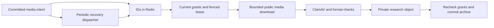

# Capture media archival

Updated: 2026-10-16. Implements a B13/B09 slice of PRD R05/R39. This is research
evidence archival; archived bytes never become authorized design/publication assets.

## Ownership and lifecycle

`CaptureService` commits immutable snapshot/media source references under forced
tenant RLS. A queued media row is the durable intent. API dispatch is best effort;
an enqueue failure retains `queued`, records `MEDIA_QUEUE_UNAVAILABLE` and produces
a partial capture receipt. It does not erase the captured fields or source.

The standard Worker now registers `QueueName.Media` and `CaptureMediaScheduler`.
The scheduler runs at startup and every minute, reserves at most 100 due rows per
tenant with row locks/skip-locked, and uses a new UUID job identity per dispatch.
Dispatch counters/cooldown prevent competing schedulers repeatedly selecting a row.
An interrupted reserve/enqueue is eligible again after a minute. Redis contains
only media/snapshot IDs; the pinned database source and original capturing actor
are authoritative. Legacy jobs carrying URLs fail the strict payload contract;
their queued database intent is recovered by the scheduler with the new contract.

Media states are `queued`, `processing`, `archived`, `failed`, `excluded`.
Each download attempt holds a five-minute database lease and a fresh token.
There are at most three processing attempts. Transient failures persist bounded
backoff; unsafe URLs, infected files, invalid formats and revoked access are
terminal. Stalled leases can be reclaimed; stale workers cannot commit or fail a
replacement execution. Due times, leases and retry deadlines use database time.
An exhausted expired lease becomes failed instead of remaining stuck.

Capture completeness and media archival are separate: a complete field capture
does not prove its media has finished archiving. Existing parser partial diagnostics
remain partial. Previously failed legacy records are not silently reset; recapture
creates a new snapshot. There is no automatic source replacement or unbounded retry.

## Network and file boundary

The downloader uses native HTTPS with the existing public-address validation
helpers. Supported Amazon roots are `media-amazon.com`, `ssl-images-amazon.com`
and `images-amazon.com`; Etsy roots are `i.etsystatic.com` and `v.etsystatic.com`.
Unknown CDNs yield an explicit diagnostic. No credentials, sensitive query keys,
IP-literal URLs, custom ports or non-HTTPS sources are allowed. Every redirect and
DNS answer is checked; the connection pins a validated public address. No cookies,
authorization headers, seller APIs or authenticated crawling are used.

DNS/HTTP share a 30-second deadline; redirects are bounded to three. Encoded bodies
are rejected. Images are limited to 12 MiB and 16 million decoded pixels; single
frame JPEG/PNG/WebP/GIF must match the response MIME and pass bounded decoding.
Videos are distinct, at most 50 MiB, with MP4/WebM container-signature checks.
Video playback, duration and codec compatibility are not validated by this slice.
ClamAV must return clean with an available signature version before parsing/storage.
Only fixed diagnostic codes enter task state; raw transport errors never do.

Open-source references used: [BullMQ idempotent jobs](https://docs.bullmq.io/patterns/idempotent-jobs),
the repository's existing Sharp/ClamAV/storage integration, and
[OWASP SSRF prevention](https://cheatsheetseries.owasp.org/cheatsheets/Server_Side_Request_Forgery_Prevention_Cheat_Sheet.html).
No new external library or alternate queue/storage platform was installed.

## Permissions and reads

Each permission retains its own role scope. Current member, source ownership,
private-read revalidation and research/project count boundaries are specified in
[research authority](research-authority.md). Tenant research reads cannot expand
self capture writes or asset reads. Private signing rechecks authority after the
storage signer returns, before returning the lease and recording success.

The Worker reloads active membership, current grants and resource ownership before
download, before storage and before committing the result. It requires current
`capture:write`, the original captured actor, an active research item and current
data scope. Research has no team ownership relationship: self/team scope is limited
to the record owner until an actual team binding exists. A queue message cannot
choose a source URL, platform, owner or permission snapshot.

`GET /v1/captures/:id` requires `capture:read` and current owner scope. Its media
projection contains archive status, allowlisted diagnostics, MIME/size/checksum
and attempt count. It does not expose object keys or execution lease tokens.

`GET /v1/captures/:id/media?after=<media UUID>` is the paginated preview model:
100 rows per page, counts for the whole snapshot, next cursor, current read
eligibility and separate parser-field/archive states. A queue dispatch failure
does not change the parser's original completeness. The cursor must belong to the
same authorized snapshot. This DTO strips raw media sources, object keys, scan
internals and lease tokens; unknown historical errors become a fixed failure code.

New rows pin `source_index` to the immutable draft's original media position;
insertion validates URL/kind at that position, and updates cannot change it.
Pages sort by this position and then UUID. Legacy NULL positions stay unpinned
and sort last; the gallery explicitly warns that their original order is unknown.
Do not infer or backfill historical order from UUIDs or current public pages.

`POST /v1/captures/:id/media/:mediaId/read-url` requires `capture:read` and `asset:read`,
current tenant/owner scope and a clean committed archive. It returns a 60-second
research-domain signed URL and records an audit event. Archived research items
cannot mint a new URL. Already-issued URLs can remain valid until their short expiry.
There is no client-selectable domain and no asset promotion/export endpoint.

The research list, snapshot gallery and creative-source thumbnails use private
archive reads. The same-origin Web BFF `/api/capture-media/:snapshotId` returns
the bounded metadata; `/:snapshotId/:mediaId` obtains a current authorized lease
server-side and streams only the configured private bucket. The browser is not
given a storage signed URL. It never falls back to the public source when private
reads fail or permission is missing. Each byte request checks current API access.
Already delivered/buffered bytes cannot be recalled; this is access control, not DRM.

The BFF forwards only a validated single byte Range to storage, validates the
returned interval/MIME/length against the authorized archive, and supports 206/416
for browser video playback. It forwards no caller cookies or API bearer to storage,
rejects redirects, and uses private/no-store/nosniff responses. There are no new
secrets; existing `S3_ENDPOINT` and `S3_PRIVATE_BUCKET` bound its destination.

The gallery shows queued/processing/archived/failed/excluded states independently
of field completeness, stable original ordinals, scan-approved images/video,
checksum/size/attempt evidence, paging and explicit read retry. Terminal archival
failure directs the operator to recapture as a new snapshot; it does not reset
history or rerun a blocked file. Native dialog navigation restores focus and
supports Escape/arrows, transitions and reduced motion. Status polls every five
seconds while work is pending and every thirty seconds afterward while visible;
list thumbnails fetch metadata only near the viewport. Current revocation or item
archival removes the preview on the next metadata read and blocks new byte reads.

Content-addressed private objects deduplicate within a tenant/domain. If storage
finishes but commit is lost or authorization changes, an unreferenced private
research object can remain. It is never exposed by this read route. Do not delete it
blindly: another immutable capture may share the checksum/key. Reference-aware
orphan cleanup remains a separate infrastructure requirement.

## Migration and local operation

Migration `0108_capture_media_archive` adds archive evidence, retry/dispatch fields,
leases, constraints and an immutable-source/result trigger. It preserves existing
source records and failed/excluded states. There is no historical archive metadata
backfill. Downgrade is not automatic; use the documented database backup/restore
procedure when rolling back an applied migration.

Migration `0111_capture_media_source_order` adds nullable original positions,
uniqueness/source-validation and immutability. It preserves legacy NULL rows and
does not claim their numbering is known. Apply it before the new API/Worker code.

Use the normal supported migration/startup flow before starting a new API/Worker.
For local scanning run `pnpm infra:file-scanning`. Existing database, Redis, S3 and
ClamAV variables apply; there are no new secrets. A stopped Worker cannot archive
or recover media. This delivery's migration was exercised only in disposable DBs;
the normal business database was not migrated or drained.

## Verification and remaining acceptance

Run `pnpm test:e2e:order-daily --suite=media-archive-integration`. The suite owns a
disposable database, S3 bucket and Redis; uses real RLS, ClamAV and BullMQ/S3 paths;
and injects only public media transport for synthetic bodies. It includes a real
antivirus test signature. Each runner invocation verifies cleanup in `finally`.
Worker unit tests separately exercise DNS/redirect/size/type attack cases.

Run `pnpm test:e2e:order-daily --suite=research-media` for the actual UI/API paths
(API 8122, Web 3126, demo flags disabled). It snapshots Web sources/cache, starts
only the media Worker, and controls only synthetic public DNS/HTTP transport.
Download policies, real scanner/storage, authentication/RLS and BFF streaming remain
active. A playable WebM is encoded through Playwright's recording support, then
archived and played through the normal private route. No paid model/marketplace
write is involved. The runner removes and verifies DB/bucket/Redis/Web snapshot.

Real public-CDN samples and unpacked-extension observations are separately recorded;
controlled transport does not prove public access, anti-bot compatibility or every
browser codec. See [this delivery](../project-control/RESEARCH_MEDIA_DELIVERY_20261016.md)
for exact evidence and remaining B13 acceptance. Reference-aware orphan cleanup,
complete marketplace capture release and the full platform still require their own
evidence.
