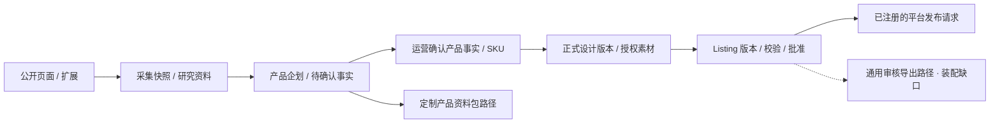
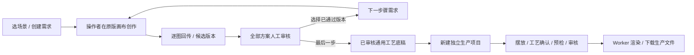
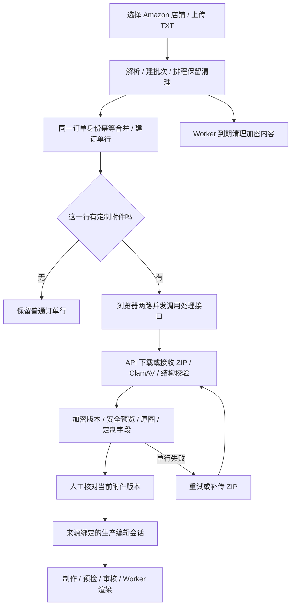
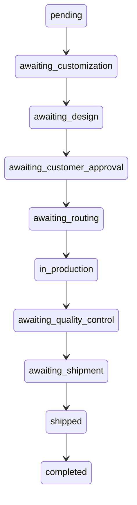
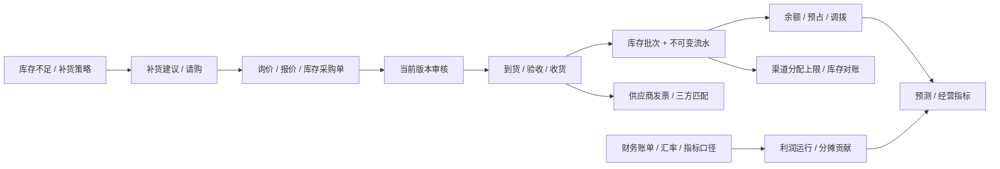

# 核心业务流程

[返回总入口](README.md)。本页把人的操作、持久化和自动执行分开。虚线为缺口、人工交接或待产品决定的连接。

## A. 从研究到产品与刊登

输入：公开证据、自己确认的商品信息、授权图片。输出分别可能是产品资料包、Listing 版本、平台发布请求，不能都叫“已上架”。

- 再采集创建快照；研究素材不转为可商用素材。产品暂定事实仍需人工确认。
- Listing 自身有直接版本批准接口；通用 `ReviewController` 的提交/决定/导出是另一条路径，目前未注册。不能把两套审核合写成一个已完成流程。
- P0 的规则边界是经审核的不可变导出包。代码已包含 P1 平台能力，不意味着 P0 到 P1 的所有交接均已验收。
- 断点：AI 分析控制器及分析消费者装配缺口；通用导出消费者装配缺口；端到端真实资料包验收需逐路径进行。

证据：[采集服务](../../apps/api/src/capture/capture.service.ts)、[产品资料包](../../apps/api/src/catalog/custom-product-package.service.ts)、[Listing 服务](../../apps/api/src/listings/listing.service.ts)、[通用审核](../../apps/api/src/reviews/review.service.ts)。

## B. SKU 前的创作到生产稿

当前固定场景包括自由创作、原创图案、备胎罩、异形抱枕。每步最多 4 个方案；下一步骤引用已批准版本。创建需求只保存任务，不自动生成图片。画布指引节点不等于算法执行记录。

生产底稿取自已审核通用生产项目；交接复制工艺参数和轮廓，新图文和确认需要重新处理。该路径不自动完成 SKU 正式绑定、商品套图或 Listing 审批。

另有批量生图链：`batch → candidate → creative version → 审核 → SKU binding → 正式 design version`，再进入套图。保留“先创意、后 SKU”与“套图前有 SKU”的不同门槛。

证据：[画布桥接](../../apps/api/src/design/canvas-bridge.service.ts)、[画布工作流](../../apps/api/src/design/canvas-workflow.service.ts)、[既有场景设计](../architecture/creative-canvas-workflows.md)。

## C. Amazon TXT 导入与订单来图

当前真实入口是 `/orders?view=reports`，`/orders/import` 是兼容跳转。

| 阶段 | 数据/执行归属 | 重要边界 |
| --- | --- | --- |
| 报告上传 | AmazonOrderReportService | TXT 上限 5 MiB、1,000 订单；已有店铺身份；不要求已完成平台授权但禁用/撤销店铺不可用 |
| 订单归一化 | OrderService | 同账号/平台/外部订单身份复用订单；不能建立第二套独立订单 |
| ZIP 拉取/补传 | 浏览器调度 API；API 校验、扫描、解析 | 手动 ZIP 上限 20 MiB；关闭页面可能留下 pending，需继续解析 |
| 原始内容与派生预览 | report line/version 的 PII 加密信封 | 当前在 PostgreSQL 存加密内容；不是自动上传为研究/商用 asset |
| 人工“已核对” | 附件 versionId | 不等于设计校样批准、生产许可或发货授权 |
| 生产编辑器 | 来源固定到报告行/版本 | Amazon 预览、买家原图、ERP 校样、生产文件应分别追踪 |
| 保留与过期 | retention queue + API 读取/操作时清理 | 本地最长 30 天窗口不被重复导入延长；本次不是平台政策合规审计 |

报告缺少可靠履约渠道、平台状态与 ship-by 时刻时保留缺失；不能据此推断 FBA、已发货或取消。解析结果变化/文件变化需新版本，不能自动沿用旧版本人工核对。

证据：[报告服务](../../apps/api/src/orders/amazon-order-report.service.ts)、[前端附件队列](../../apps/web/src/features/orders/amazon-report-workspace.tsx)、[报告接入说明](../integration/amazon-order-reports.md)。

## D. 当前订单主状态与真实履约

这是 [order-state-machine.ts](../../apps/api/src/orders/order-state-machine.ts) 的实际主状态图；`on_hold` 和 `cancelled` 是独立侧状态，会阻止普通流转。平台状态也与本地工作流分离。

当前 `production_orders.order_id / order_line_id` 为必填。它适合客户订单生产，无法直接表达没有客户订单的库存备货需求。渠道库存存在 FBA 信息，不意味着已实现 FBA 备货、装箱、入仓和差异处理完整模块。

**重构建议，尚未实施：** 用订单行履约计划分别承载普通 FBM、定制 FBM、平台履约销售；库存备货采用独立需求来源。UI 可以共用订单工作台，状态图不必共用。是否需要备货生产、FBA 入仓及其先后次序仍需产品决策。

已有履约链：定制 requirement/校样 → 供应商规则与派单决定 → 生产单版本 → 工序事件/质检 → 包裹分配/发货版本审核 → 平台回传/状态对账 → 物流轨迹/售后。生产编辑器文件与这条链的统一交付契约，应在下一阶段用具体订单走通。

## E. 库存采购与经营分析

库存采购 `inventory_purchase_orders` 与客户履约采购 `purchase_orders` 是两个明确存在的域，不能只因名字相近就删掉其中一个。前者为仓库买货，后者服务客户订单的供应商履约。

财务要求明确来源、币种、汇率与口径；缺少必要证据可能返回 null，不能用零填充伪装完整利润。广告/VOC 建议与预测输出都是待审核决策资料，不自动修改广告预算、采购单、价格或 Listing。

## F. 平台发布与不确定结果

当前连接器代码区分 Amazon 校验预览与真实提交，区分 Etsy 草稿创建与激活。平台接受也不直接等于商品可购买；需要回读状态。外部写结果不确定时进入 reconciliation，避免重复创建/重复提交。

这条路径已有实现和模拟连接器测试入口，但本次没有验证任何真实店铺。上线前必须使用已授权的测试目标验证，不能用浏览器模拟卖家后台发布。[平台发布说明](../integration/marketplace-publications.md)。
