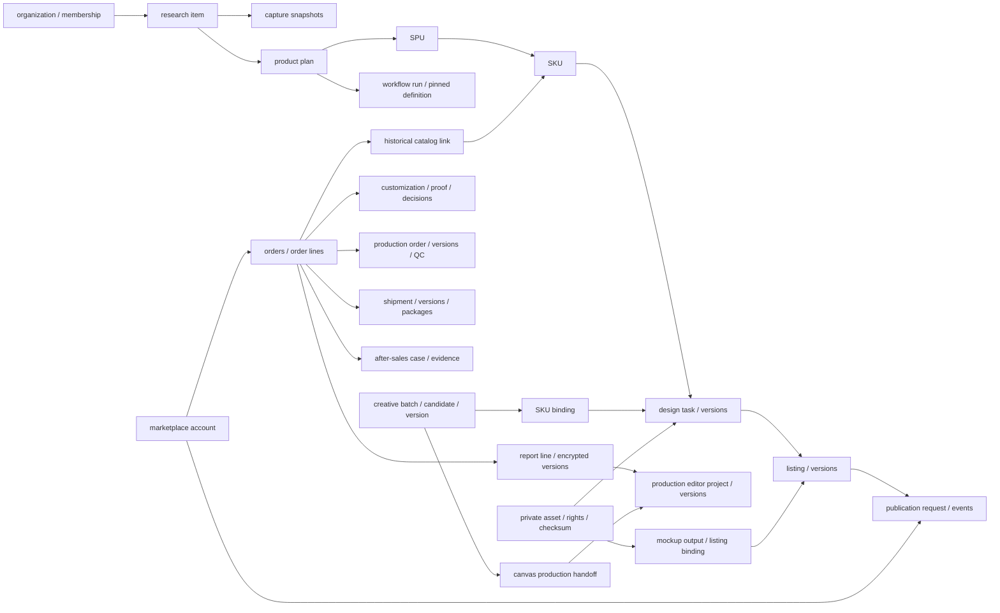

# 数据、状态与归属地图

[返回总入口](README.md)。222 个表的逐表目录在 [generated/tables.md](generated/tables.md)，列定义在 [inventory.json](generated/inventory.json)。以下是面向重构的业务归属，不是新的数据库迁移。

## 主要实体关系

箭头是业务引用和来源关系，不声明每条边都有数据库外键或固定一对多关系。准确约束以 schema 和 SQL 迁移为准，特别是 tenant 复合外键。

## 业务数据归属

| 业务域 | 主要身份/当前状态 | 历史或证据 | 重构保留要求 |
| --- | --- | --- | --- |
| 身份资产 | organizations、memberships、roles、asset_files | audit_events、文件 SHA-256、来源/权利信息 | 保留 tenant 与访问范围；资产域不混用 |
| 研究 | research_items、competitor_shops | capture_snapshots、capture_media、competitor_shop_snapshots | 旧快照不可覆盖，缺失字段保留诊断 |
| AI | model_provider_configs、model_routes、ai_budget_policies | analysis_reports、ai_budget_ledger、generated_image_provenance | 分析版本、模型与成本来源保留 |
| 产品 | product_plans、spus、skus、supplier_candidates | 固定到工作流/订单的产品快照 | SKU 与历史订单关联不可被新商品修改 |
| 产品工作流 | workflow_definitions、workflow_runs、workflow_node_runs | definition_versions、node_attempts、artifact_links、run_events | 已有运行绑定旧定义版本；旧 Amazon SOP 表保留迁移依据 |
| 设计 | design_tasks | design_versions、design_version_files | 审核对应版本；新内容另建版本 |
| 创意/套图 | creative_design_batches/items、mockup_batches/items | candidates、creative_design_versions/assets、sku_bindings、print_spec_versions、template_pack_versions、mockup_batch_outputs | 创意母版、正式设计、商品场景图分别可追溯 |
| POD 治理 | pod_artwork_tasks | task_inputs、recipe_versions、rights_assessments、artifact_relations、visual_fingerprints、listing_artifact_bindings、pod_export_packages | 权利和来源门槛覆盖导出与绑定 |
| 定制模板 | sku_template_bindings、order_personalization_batches/items、render_tasks | template_source_inspections、personalization_template_versions、template_slots、production_manifests | 订单字段解析固定模板版本；不混用通用 AI 配置 |
| 生产编辑 | production_editor_projects | versions、images、renders、canvas_production_handoffs | 报告来源项目与通用项目分开；历史版本/文件可追溯 |
| Listing | listings | listing_versions、listing_replications | 内容、批准版本和平台发布版本分别固定 |
| 平台连接 | marketplace_accounts、credentials、authorization_sessions、automation_rules | capability_snapshots、publication_requests/events/batches、sync_requests/events、quota_snapshots、automation_runs | 不能遗失已产生外部副作用的身份和回传证据 |
| 订单内核 | orders、order_exceptions、connector_checkpoints、ingestion_runs | order_lines、source_snapshots、external_references、events、exception_events、ingestion_risks、catalog_links | 外部身份唯一、事件序列、幂等和历史 SKU 关联 |
| 订单隐私 | order_protected_details、report_lines | protected_access_events、report_batches/items/versions | 加密域、到期时间、擦除事实不可因迁移恢复 |
| 定制审核 | order_customization_requirements | customization_versions、file_intakes、scan_events、proof_versions、proof_decisions | 扫描通过、核对通过、校样批准不是同一状态 |
| 派单履约 | fulfillment_suppliers、production_orders、shipments、after_sales_cases、automation_tasks | supplier snapshots/quotes、routing decisions、production versions/QC、shipment versions/writeback/tracking、售后事件 | 人工覆盖理由、质检证据和不确定平台结果保留 |
| 库存 | warehouses、locations、stock_items、lots、balances、reservations、transfers | movements、reservation_events、transfer_events、projection_rebuilds | 流水是真源，余额可重建，不能只搬余额 |
| 库存采购 | requisitions、RFQs、inventory_purchase_orders、replenishment_policies | versions、events、receipts/lines、invoices/lines、suggestions | 收货、入库、发票差异及单位/币种保留 |
| 渠道库存 | allocation_policies、availability_projections、mutation_reconciliations | network snapshots/lines/checkpoints、policy_versions、allocation_runs、reconciliation_events | 物理库存、可分配量、平台数量不可混为一个值 |
| 财务 | profit_metrics | statements、facts、fx_rates、metric_versions、profit_runs/contributions | 货币最小单位、冲销/更正链与计算口径保留 |
| 广告/VOC/供应商绩效 | definitions、recommendations | reports/metric_lines、signal_facts、analysis_runs/themes、review_events、scorecards/metrics | 期间、归因窗口、定义版本、证据截止时间保留 |
| 经营/集成 | metric_definitions/projections、reconciliations、api_clients、webhook_endpoints/deliveries | forecast runs/points/evaluations/overrides、metric snapshots、events、delivery attempts、retention runs | 分析结果与业务命令分离；签名、重放与去重保持 |

表中较长域使用业务缩写，精确 SQL 名见全量目录。通用 `ReviewService` 的 repository 接口不等于已有独立 Drizzle 审核/导出表；当前独立注册和持久化装配需要补查，不将其补画为已实现表。

## 五类素材必须讲清楚

| 素材 | 当前用途/存储方式 | 可以直接成为生产或刊登素材吗 |
| --- | --- | --- |
| 竞品图/研究截图 | research 域，分析证据 | 不可以 |
| 自有/已授权设计图 | authorized 域，权利状态与校验值 | 还需具体版本、用途和审核 |
| 隔离中的买家上传 | quarantine 或订单专用加密链 | 需扫描、授权与来源绑定 |
| 报告 ZIP/买家信息 | order-report 加密信封，当前在数据库 | 只经受保护订单路径访问，不自动进入商用素材库 |
| Amazon 预览 / ERP 校样 / 最终生产稿 | 不同来源、用途和审核含义 | 预览或“已核对”不能替代最终生产验收 |

生产编辑器还有自身的图片、版本与渲染产物记录，应保留其订单隐私来源与通用来源区分；不要为了统一“素材库”删除这条隔离线。

## 状态的层次

重构时建议在产品界面呈现“对象 + 当前待办 + 阻塞原因”，底层保留这些独立状态：

- 平台状态：平台告诉我们的订单/刊登状况。
- 本地履约状态：订单处在何种运营环节。
- 资料状态：报告/ZIP 是否下载、解析、完整、过期。
- 审核状态：哪个版本由谁针对什么用途批准。
- 生产状态：工序、质检、返工以及实际文件交付。
- 异步任务状态：排队、执行、失败、重试、死信。
- 外部写回状态：请求、接受、未知、待对账、回读确认。

统一 UI 不应压成一个 `status=completed`。例如报告“已核对”只表示附件版本已人工检查；不能推出“已审图”“已生产”“已发货”。

## 迁移前必须建立的对账表

| 迁移对象 | 应核对的键/证据 | 回退注意点 |
| --- | --- | --- |
| 租户/账号 | tenant、membership、权限、账号外部身份 | 不能把原来跨租户分开的编号合并 |
| 订单/订单行 | account/platform/external ID、行身份、事件序列 | 不回退已确认的平台写操作 |
| 商品/设计/Listing | 原 ID、新 ID、版本 ID、SHA-256、历史关联 | 不把最新版本覆盖到历史订单 |
| 文件 | 域、对象引用、校验值、到期/已擦除状态 | 不从备份复活已到期 PII |
| 库存 | 流水、数量单位、预占、调拨、重建余额 | 用流水对账，不仅比较总余额 |
| 财务 | 原币/本位币、汇率有效时点、冲销、更正、指标版本 | 不把缺失费用当零 |
| 发布/发货回写 | 外部 ID、请求幂等键、已发送事件、未知结果 | 未知结果先回读，不重复发送 |

尚未执行数据抽取、迁移、库结构修改或恢复演练。本表是未来重构的验收约束。
