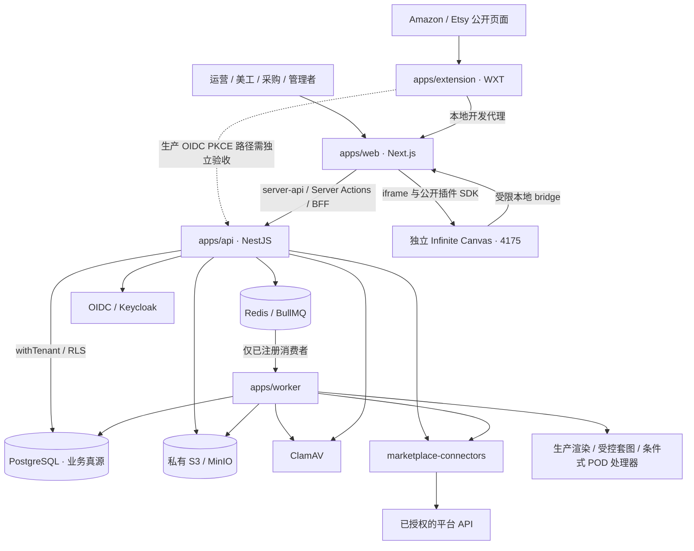
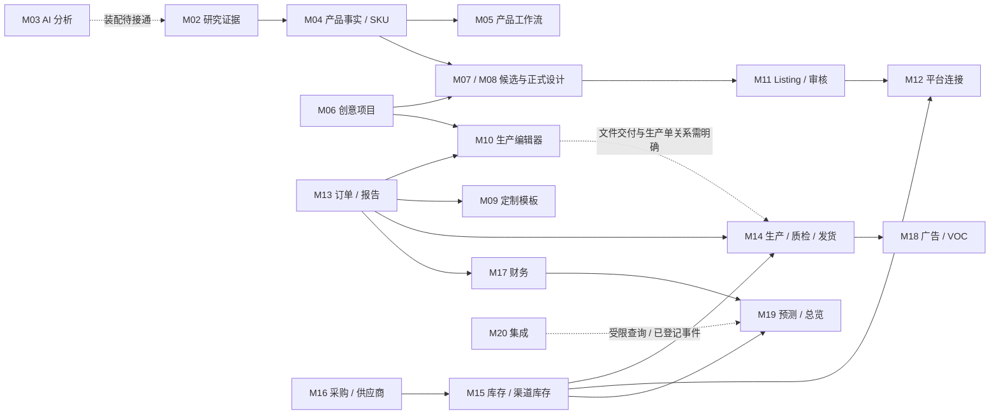

# 系统地图

[返回总入口](README.md)。本页描述 2026-09-12 代码基线，实线表示代码中存在的调用/依赖方向，条件和未接通部分另行标明；不是运行健康图。

## 技术组成



实现采用 monorepo 与模块化单体方向。**API 当前只有一个 `AppModule` 集中装配业务控制器与服务**，尚未按 20 个阅读模块形成独立 Nest Module。四个应用可以分别运行；这不表示它们已经是独立业务微服务。[入口源码](../../apps/api/src/app.module.ts)、[ADR-001](../architecture/adr-001-modular-monolith.md)。

## 目录地图

```text
YummyAI/
├─ apps/web/                 页面、交互、Server Actions、本地 BFF
├─ apps/api/                 认证、业务命令、查询、服务装配
├─ apps/worker/              后台执行、重试、扫描、平台调用、渲染
├─ apps/extension/           公开页面 DOM 采集与评论采集控制
├─ packages/contracts/      跨应用 Zod 契约与传输类型
├─ packages/database/       Drizzle 表、SQL 迁移、RLS 事务
├─ packages/authz/          权限与数据范围
├─ packages/storage/        私有对象、文件权利、校验与资料包
├─ packages/jobs/           队列名、任务信封、载荷契约
├─ packages/ai-core/        模型适配、路由、预算、加密工具
├─ packages/platform-rules/ Amazon / Etsy 版本化本地校验
├─ packages/marketplace-connectors/ 授权、能力、订单/刊登等连接器
├─ packages/production-editor/      几何、文字、轮廓、渲染
├─ packages/mockup-renderer/        受控 PSD 编译与套图
├─ packages/infinite-canvas-plugin/ 原版画布的公开 SDK 插件
├─ infra/                   Docker、身份与基础设施配置
├─ tools/                   启动、检查、备份恢复、E2E 与分割工具
└─ docs/                    需求、ADR、接口、运维与本地图
```

## 当前用户导航

以下顺序来自 [navigation-registry.ts](../../apps/web/src/features/navigation/navigation-registry.ts) 的 `SIDEBAR_GROUPS`，不是沿用旧文档的菜单。

| 一级分组 | 主入口 | 辅助或历史入口 |
| --- | --- | --- |
| 总览 | `/` 运营总览 | `/navigation` 全部功能 |
| 订单与履约 | `/orders` 订单工作台；`/stores` 店铺运营 | `/orders?view=reports` 导入与定制；按 workflowState 筛选 |
| 创意设计 | `/creative-designs/canvas` 创意工作台；`/pod-workbench/production-editor` 生产文件与底稿；`/pod-workbench/mockup-batches` 商品套图 | `/creative-designs` 批量生图；`/pod-workbench` 图片处理；`/design` 设计任务与校样 |
| 商品与刊登 | `/products`；`/workflows`；`/listings` | 企划、流程模板/运行、刊登详情 |
| 选品研究 | `/research`；`/competitors` | `/analysis/[reportId]` 分析详情 |
| 采购与库存 | `/inventory`；`/procurement`；`/supplier-performance`；`/channel-inventory` | 具体对象在工作台内操作 |
| 经营分析 | `/finance`；`/customer-intelligence`；`/operating-cockpit` | 数据与集成共用经营页面 |

兼容跳转：`/orders/import` → `/orders?view=reports`；`/pod-workbench/batch-designs` → `/creative-designs` 并保留查询参数；`/amazon-custom-sop` → 工作流入口或已有运行。`/creative-designs` 在选中特定 bridge 批次时也会条件跳转，不能将整个页面标成已废弃。完整 30 页见[路由清单](generated/routes.md)。

## 模块之间的主要关系



M01 租户、权限、资产与审计横贯全部模块。图中的依赖包括业务读取、数据引用和操作交接；不表示每条边都具有自动任务。

## 共享包的边界

| 包 | 应负责什么 | 重构时应避免什么 |
| --- | --- | --- |
| contracts | 跨层请求、响应、事件、状态类型 | 把整张数据库行当作公共 API；反复复制 Schema |
| database | 存储结构、迁移、tenant transaction | 让任意模块随意修改其他域历史 |
| authz | 权限、范围判定 | 页面隐藏按钮代替服务端鉴权 |
| storage | 域/权利检查、私有读、字节校验 | 将研究素材、客户图片和商用素材混为一库 |
| jobs | 标识符载荷、队列与重试协议 | 仅加队列名而不装配消费者 |
| ai-core | 模型协议、路由、预算 | 将买家数据直接送入通用生图配置 |
| platform-rules | 本地平台字段校验 | 将本地通过等同于平台接受 |
| marketplace-connectors | 外部 API 语义与错误归一化 | 在业务服务或 UI 内散落平台请求 |
| production-editor | 可复用的几何和渲染能力 | 将订单/租户权限决策塞进画布几何工具 |
| mockup-renderer | 支持范围内的 PSD 编译与渲染 | 宣称可完整替代任意 Photoshop 文件 |
| infinite-canvas-plugin | 公开 SDK 接入和回传协议 | 依赖宿主内部 store 或直接写宿主数据库 |

package.json 的依赖边完整保存在 [inventory.json](generated/inventory.json)。例如 Web 对 database 的开发依赖，不足以证明页面绕过 API 写库；不能仅凭依赖声明判定违规。

## 运行与配置地图

日常入口是 `pnpm start:local`；Node 24.17.x、pnpm 11.10.x。Web 常用 3000，API 8000，扩展开发 3001；独立画布 4175。数据库 5432、Redis 6379、MinIO 9000/9001、Keycloak 8081、ClamAV 3310。覆盖配置以[本地运维文档](../operations/local-development.md)为准，端口不是本次在线检查结果。

| 能力 | 关键依赖/开关 | 源码状态 |
| --- | --- | --- |
| 基础页面与业务查询 | API、PostgreSQL、OIDC | 主入口已装配；本次未启动或探测 |
| 报告附件解析 | API、ClamAV；页面负责两路并发请求 | 浏览器关闭会留下待解析行 |
| 报告保留清理 | Redis + Worker | `amazon-order-report-retention` 已有启动调用 |
| 生产稿渲染 | Worker、存储、production-editor | 已有启动调用；预检/审核仍是门槛 |
| 普通 POD 处理 | `POD_PROCESSOR_*`、部署标识、工具 allowlist | 条件式启用 |
| 订单定制渲染 | 单独 `POD_ORDER_PROCESSOR_*` | 与普通 POD 配置隔离，条件式启用 |
| 批量设计 | `POD_BATCH_WORKFLOWS_ENABLED` + 指定工具 | 条件式启用 |
| 商品套图 | `POD_MOCKUP_RENDERER_ENABLED`、ImageMagick、已审模板 | 条件式启用 |
| 原版创意画布 | 独立宿主、插件、受限 BFF | 操作者在画布制作；创建需求不触发生图 |
| 产品内部工作流任务 | workflow-node producer | 标准 Worker 未发现消费者启动 |

本次没有读取 `.env` 中的实际值，因此“条件式启用”不表示本机已经配置成功。
